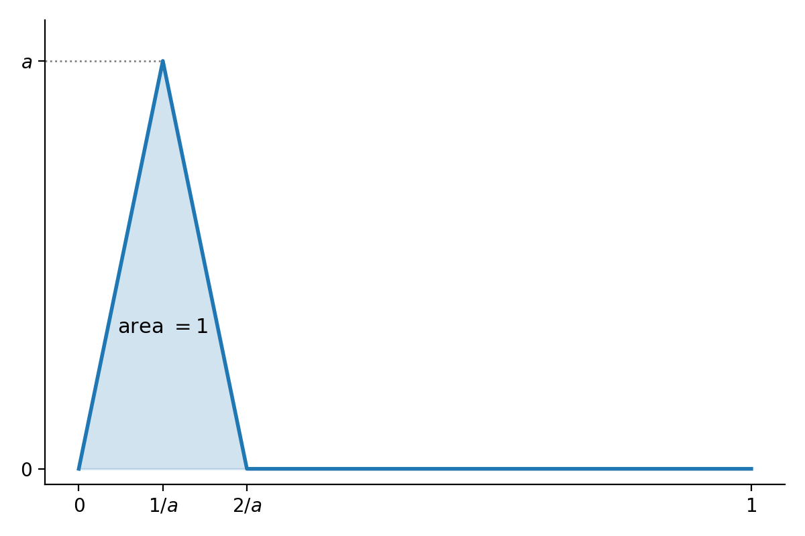

## Overview

- Norms on vector spaces; all norms on a finite-dimensional space are equivalent.
- Matrix norms: the operator (spectral) norm and the Frobenius norm, and their relation to singular values.
- Proof that the truncated SVD $A_k$ is the best rank $k$ approximation in both norms.
- The Courant minimax principle.

Reference: Conrad, [Computing the Norm of a Matrix](https://kconrad.math.uconn.edu/blurbs/linmultialg/matrixnorm.pdf).

# Vector Space Norms

## Norms

Let $V$ be a vector space over $F=\R$ or $\C$. A **norm** on $V$ is a function $\|\cdot\|:V\to\R$ such that:

- $\|v\|\ge 0$, with equality if and only if $v=0$;
- $\|v+w\|\le\|v\|+\|w\|$;
- $\|cv\|=|c|\|v\|$ for $c\in F$.

Dropping "$\|v\|=0$ only if $v=0$" gives a **seminorm**.

A norm makes $V$ a metric space with $d(v,w)=\|v-w\|$.

## Two Key Examples

**The sup norm** relative to a basis $e_1,\ldots,e_n$:
$$
\Bigl\|\sum_{i=1}^{n}a_ie_i\Bigr\|_{\mathrm{sup}}=\max\{|a_1|,\ldots,|a_n|\}.
$$

**The $\ell^2$ (Euclidean) norm** from an inner product:
$$
\|v\|=\sqrt{\langle v,v\rangle}.
$$
For the usual dot product, this gives Euclidean distance.

## The Triangle Inequality for $\ell^2$

Cauchy--Schwarz: $|\langle v,w\rangle|\le\sqrt{\langle v,v\rangle\langle w,w\rangle}$. So
$$\begin{aligned}
\|v+w\|^2&=\langle v,v\rangle+2\re\langle v,w\rangle+\langle w,w\rangle\\
&\le\|v\|^2+2|\langle v,w\rangle|+\|w\|^2\\
&\le\|v\|^2+2\|v\|\|w\|+\|w\|^2=(\|v\|+\|w\|)^2.
\end{aligned}$$
Take square roots.

## Equivalent Norms

**Definition.** Norms $\|\cdot\|_a$ and $\|\cdot\|_b$ on $V$ are **equivalent** if there are constants $A,B>0$ with
$$
A\|v\|_a\le\|v\|_b\le B\|v\|_a\quad\text{for all }v\in V.
$$

**Proposition.** All norms on a finite-dimensional vector space $V$ over $\R$ or $\C$ are equivalent.

Strategy: fix a basis $e_1,\ldots,e_n$ and show that any norm $\rho$ is equivalent to $\supnorm{\cdot}$ for that basis.

## The Upper Bound

For $v=\sum_{i=1}^{n}a_ie_i$:
$$\begin{aligned}
\rho(v)&\le\sum_{i=1}^{n}|a_i|\rho(e_i)
\le\Bigl(\sum_{i=1}^{n}\rho(e_i)\Bigr)\supnorm{v}.
\end{aligned}$$
So $\rho(v)\le B\supnorm{v}$ with $B=\sum_i\rho(e_i)$.

**Lemma.** $\rho$ is continuous for the metric given by $\supnorm{\cdot}$:
$$
|\rho(x)-\rho(y)|\le\rho(x-y)\le B\supnorm{x-y}.
$$

This much works for seminorms too. The next step needs $\rho(v)=0\Rightarrow v=0$.

## Compactness of the Sphere

**Lemma.** The unit sphere $S=\{v:\supnorm{v}=1\}$ is compact.

**Proof.**

- The closed ball $\{\supnorm{v}\le 1\}$ is a finite product of intervals $[-1,1]$ (or closed disks $|z|\le 1$), so it is compact.
- The open ball $\{\supnorm{v}<1\}$ is a finite product of open intervals (or open disks), so it is open.
- $S$ is the closed ball minus the open ball, so it is closed, hence compact. $\square$

## The Lower Bound

$\rho$ is continuous on the compact set $S$, so it attains a minimum $A$, and $A>0$ since $\rho$ is nonzero on $S$.

For $v\neq 0$:
$$
\rho\Bigl(\frac{v}{\supnorm{v}}\Bigr)\ge A
\quad\Longrightarrow\quad
\rho(v)\ge A\supnorm{v}.
$$

Altogether:
$$
A\supnorm{v}\le\rho(v)\le B\supnorm{v}.\qquad\square
$$

## Remarks and Consequences

- The key input is compactness of closed intervals in $\R$ or closed disks in $\C$ (Heine--Borel).
- Conrad, [Equivalence of Norms](https://kconrad.math.uconn.edu/blurbs/gradnumthy/equivnorms.pdf): all norms on a finite-dimensional vector space over a complete valued field are equivalent.

**Corollary.** For finite-dimensional $V$, $W$ over $\R$ or $\C$:

- every linear map $V\to W$ is continuous in any norm topology;
- bounded, open, closed and compact sets are the same for every norm.

## Infinite Dimensions Are Different

On $C([0,1])$ consider
$$
\supnorm{f}=\sup_{0\le x\le 1}|f(x)|,\qquad
\|f\|_{L^1}=\int_0^1|f(x)|\,dx.
$$

A spike of height $a$ and area $1$ has $\supnorm{f}=a$ and $\|f\|_{L^1}=1$. So there is no $B$ with $\supnorm{f}\le B\|f\|_{L^1}$: the norms are not equivalent.

{height=42%}

# Matrix Norms

## Matrices as Vectors

$M_{n\times m}(F)\cong F^{nm}$, so matrices have:

- the sup norm $\supnorm{A}=\max_{i,j}|a_{ij}|$;
- the **Frobenius norm** $\frobnorm{\cdot}$, the $\ell^2$ norm on $F^{nm}$.

All norms on $M_{n\times m}(F)$ are equivalent.

## The Seminorm $\rho_A$

For $A\in M_{n\times m}(F)$ let
$$
\rho_A(v)=\|Av\|,
$$
where $\|v\|$ is the $\ell^2$ norm on $F^m$ and $\|Av\|$ is the $\ell^2$ norm on $F^n$.

$\rho_A$ is a seminorm on $F^m$:

- $\rho_A(v)\ge 0$;
- $\rho_A(v+w)=\|Av+Aw\|\le\rho_A(v)+\rho_A(w)$;
- $\rho_A(av)=|a|\rho_A(v)$.

So $\rho_A$ is continuous, and $\rho_A(v)\le C\|v\|$ for some $C\ge 0$.

## The Operator Norm

**Proposition.** There is a smallest $b\ge 0$ with $\rho_A(v)\le b\|v\|$ for all $v$.

**Proof.**

- The sphere $\{v\in F^m:\|v\|=1\}$ is closed and bounded, hence compact, so $\rho_A$ attains a maximum $b=\rho_A(v_0)$ on it.
- For $v\ne 0$, $\rho_A(v/\|v\|)\le b$, so $\rho_A(v)\le b\|v\|$.
- If $\rho_A(v)\le c\|v\|$ for all $v$, then taking $v=v_0$ gives $b\le c$. $\square$

**Definition.** The **operator norm** of $A$ is
$$
\|A\|=\max_{v\in F^m,\ \|v\|=1}\|Av\|.
$$

## Properties of the Operator Norm

**Proposition.** The operator norm is a norm on $M_{n\times m}(F)$, and for $B\in M_{m\times p}(F)$:

- $\|AB\|\le\|A\|\|B\|$;
- $\|A^{*}\|=\|A\|$;
- $\|A^{*}A\|=\|AA^{*}\|=\|A\|^2$;
- $|\langle Av,w\rangle|\le\|A\|\|v\|\|w\|$ for $v\in F^m$, $w\in F^n$;
- $\supnorm{A}\le\|A\|\le\sqrt{nm}\,\supnorm{A}$.

So the operator norm gives $M_{n\times m}(F)$ the topology of $F^{nm}$, and $M_{n\times m}(F)$ is complete for it.

(Conrad, Theorem 3.4.)

## Proofs: Products and Inner Products

**Products.**
$$
\|ABv\|\le\|A\|\|Bv\|\le\|A\|\|B\|\|v\|,
$$
and $\|AB\|$ is the smallest such constant, so $\|AB\|\le\|A\|\|B\|$.

**Inner products.** By Cauchy--Schwarz,
$$
|\langle Av,w\rangle|\le\|Av\|\|w\|\le\|A\|\|v\|\|w\|.
$$

## Proof: the Adjoint

$A^{*}$ is the conjugate transpose ($A^{\top}$ when $F=\R$). By Cauchy--Schwarz,
$$
\|Av\|^2=\langle v,A^{*}Av\rangle\le\|v\|\|A^{*}Av\|\le\|A^{*}A\|\|v\|^2.
$$
Maximize over unit $v$ and use the product bound:
$$
\|A\|^2\le\|A^{*}A\|\le\|A^{*}\|\|A\|.
$$

- If $A\ne 0$, divide by $\|A\|$: $\|A\|\le\|A^{*}\|$.
- Apply this to $A^{*}$: $\|A^{*}\|\le\|A\|$. So they are equal.
- Then $\|A\|^2\le\|A^{*}A\|\le\|A\|^2$.
- Applying this to $A^{*}$ gives $\|AA^{*}\|=\|A^{*}\|^2=\|A\|^2$. $\square$

## Self-Adjoint Matrices

**Proposition.** If $A\in M_n(F)$ and $A=A^{*}$, then
$$
\|A\|=\max_{\|v\|=1}|\langle Av,v\rangle|=\max\{|\lambda|:\lambda\text{ an eigenvalue of }A\}.
$$

The **Rayleigh quotient**
$$
R(v)=\frac{|\langle Av,v\rangle|}{\|v\|^2},\qquad v\ne 0,
$$
is continuous and scale invariant, so it attains a maximum $\mu$ on the unit sphere and
$$
|\langle Av,v\rangle|\le\mu\|v\|^2\quad\text{for all }v.
$$
Since $|\langle Av,v\rangle|\le\|A\|\|v\|^2$, we have $\mu\le\|A\|$.

## Proof: $\|A\|\le\mu$

**Polarization.** Since $A=A^{*}$,
$$
\langle A(v+w),v+w\rangle-\langle A(v-w),v-w\rangle=4\re\langle Av,w\rangle.
$$
So, using $\|v+w\|^2+\|v-w\|^2=2(\|v\|^2+\|w\|^2)$,
$$
4|\re\langle Av,w\rangle|\le\mu\bigl(\|v+w\|^2+\|v-w\|^2\bigr)=2\mu(\|v\|^2+\|w\|^2).
$$
For unit $v,w$ this gives $|\re\langle Av,w\rangle|\le\mu$; by scaling,
$$
|\re\langle Av,w\rangle|\le\mu\|v\|\|w\|.
$$
Take $w=Av$: $\|Av\|^2\le\mu\|v\|\|Av\|$, so $\|Av\|\le\mu\|v\|$. Hence $\|A\|=\mu$.

## Proof: the Eigenvalue

Choose a unit vector $u$ with $|\langle Au,u\rangle|=\|A\|$, and let $\alpha=\langle Au,u\rangle=\pm\|A\|$ (real since $A=A^{*}$). Then
$$\begin{aligned}
0\le\|Au-\alpha u\|^2&=\|Au\|^2-2\alpha\langle Au,u\rangle+\alpha^2\\
&=\|Au\|^2-\alpha^2\le\|A\|^2-\alpha^2=0.
\end{aligned}$$
So $Au=\alpha u$, and $\pm\|A\|$ is an eigenvalue.

Every eigenvalue satisfies $|\lambda|\|v\|=\|Av\|\le\|A\|\|v\|$, so
$$
\|A\|=\max_i|\lambda_i|.\qquad\square
$$

## The Spectral Norm

**Corollary.** For any $n\times m$ matrix $A$, $\|A\|=\sigma_1$, the largest singular value of $A$.

**Proof.** $\|A\|^2=\|A^{*}A\|$, and $A^{*}A$ is self-adjoint with eigenvalues $\sigma_i^2$ (and zeros). The largest is $\sigma_1^2$. $\square$

This is why the operator norm is also called the **spectral norm**.

## The Frobenius Norm

$$
\frobnorm{A}^2=\sum_{i,j}|a_{ij}|^2.
$$

**Lemma.** The inner product $\langle(a_{ij}),(b_{ij})\rangle=\sum a_{ij}\overline{b_{ij}}$ on $M_{n\times m}(F)$ is
$$
\langle A,B\rangle=\trace{B^{*}A},\qquad\text{so}\qquad\frobnorm{A}^2=\trace{A^{*}A}.
$$

**Proposition.** If $\sigma_1\ge\cdots\ge\sigma_r$ are the singular values of $A$, then
$$
\frobnorm{A}=\sqrt{\sum_{i=1}^{r}\sigma_i^2}.
$$

**Proof.** $\trace{A^{*}A}$ is the sum of the eigenvalues of $A^{*}A$, which are the $\sigma_i^2$ and zeros. $\square$

The spectral norm sees the largest singular value; the Frobenius norm sees them all.

# Low Rank Approximation: Proofs

## The Problem

Given $A\in M_{n\times m}(F)$, find $A_k$ of rank at most $k$ with

- $\|A-A_k\|\le\|A-B\|$ (operator norm), and
- $\frobnorm{A-A_k}\le\frobnorm{A-B}$ (Frobenius norm)

for all $B$ of rank at most $k$.

The answer to both is the truncated SVD. (Following Wikipedia, [Low-rank approximation](https://en.wikipedia.org/wiki/Low-rank_approximation).)

$A$ and $A^{*}$ have the same rank and norms, so assume $n\le m$, and let
$$
A=U\Sigma V^{*},\qquad\sigma_1\ge\cdots\ge\sigma_n\ge 0.
$$

## Two Lemmas

Let $v_1,\ldots,v_m$ be the columns of $V$ (the right singular vectors).

**Lemma A.** For $1\le j\le n$, if $w=\sum_{i=1}^{j}\gamma_iv_i$ is a unit vector, then $\|Aw\|\ge\sigma_j$.

**Proof.** $\sum_{i=1}^{j}|\gamma_i|^2=1$. $V^{*}w$ has entries $\gamma_1,\ldots,\gamma_j,0,\ldots,0$, so $h=\Sigma V^{*}w$ has entries $\sigma_1\gamma_1,\ldots,\sigma_j\gamma_j,0,\ldots,0$. Since $U$ is unitary,
$$
\|Aw\|^2=\|Uh\|^2=\sum_{i=1}^{j}\sigma_i^2|\gamma_i|^2\ge\sigma_j^2\sum_{i=1}^{j}|\gamma_i|^2=\sigma_j^2.\qquad\square
$$

**Lemma B.** Set $\sigma_i=0$ for $n<i\le m$. If $w$ is a unit vector in the span of $v_j,\ldots,v_m$, then $\|Aw\|\le\sigma_j$.

**Proof.** The same computation. $\square$

## The Operator Norm Result

**Proposition.** For $k<n$ let $A_k=\sum_{i=1}^{k}\sigma_iu_iv_i^{*}$. Then for every $B$ of rank at most $k$,
$$
\|A-B\|\ge\|A-A_k\|=\sigma_{k+1}.
$$

**Proof.**

- $\|A-A_k\|=\sigma_{k+1}$, the largest singular value of $A-A_k=\sum_{i>k}\sigma_iu_iv_i^{*}$.
- Let $S=\operatorname{span}(v_1,\ldots,v_{k+1})$, of dimension $k+1$. Since $B(S)$ has dimension at most $k$, rank--nullity gives a unit vector $w\in S\cap\ker B$.
- Then, by Lemma A with $j=k+1$,
$$
\|A-B\|^2\ge\|(A-B)w\|^2=\|Aw\|^2\ge\sigma_{k+1}^2.\qquad\square
$$

## The Frobenius Norm: Setup

Since the $u_iv_i^{*}$ are orthonormal in the Frobenius inner product,
$$
\frobnorm{A-A_k}^2=\Bigl\|\sum_{i=k+1}^{n}\sigma_iu_iv_i^{*}\Bigr\|_F^2=\sum_{i=k+1}^{n}\sigma_i^2.
$$

We must show $\frobnorm{A-A_k}^2\le\frobnorm{A-B}^2$ for all $B$ of rank at most $k$.

**Lemma (Weyl).** If $A=A'+A''$ and $i+j-1\le n$, then
$$
\sigma_{i+j-1}(A)\le\sigma_i(A')+\sigma_j(A'').
$$

## Proof of Weyl's Inequality

Note $\sigma_1(A-A_i)=\sigma_{i+1}(A)$, with $A_0=0$. So, by the triangle inequality for the spectral norm,
$$\begin{aligned}
\sigma_i(A')+\sigma_j(A'')&=\sigma_1(A'-A'_{i-1})+\sigma_1(A''-A''_{j-1})\\
&\ge\sigma_1(A-A'_{i-1}-A''_{j-1}).
\end{aligned}$$

- $A'_{i-1}+A''_{j-1}$ has rank at most $i+j-2$: the column space of $R+S$ lies in the sum of the column spaces of $R$ and $S$.
- By the operator norm result with $k=i+j-2$,
$$
\sigma_1(A-A'_{i-1}-A''_{j-1})\ge\sigma_{i+j-1}(A).\qquad\square
$$

## The Frobenius Norm Result

Let $B$ have rank at most $k$. Apply Weyl to $A=(A-B)+B$ with $1\le i\le n-k$ and $j=k+1$:
$$
\sigma_i(A-B)+\sigma_{k+1}(B)\ge\sigma_{i+k}(A).
$$
But $\sigma_{k+1}(B)=0$, so $\sigma_i(A-B)\ge\sigma_{i+k}(A)$, and
$$\begin{aligned}
\frobnorm{A-B}^2&=\sum_{i=1}^{n}\sigma_i(A-B)^2
\ge\sum_{i=1}^{n-k}\sigma_{i+k}(A)^2\\
&=\sum_{i=k+1}^{n}\sigma_i(A)^2=\frobnorm{A-A_k}^2.\qquad\square
\end{aligned}$$

# The Courant Minimax Principle

## Minimax for Singular Values

**Proposition.** For $1\le k\le n$, with $S$, $T$ ranging over subspaces of $F^m$,
$$
\sigma_k(A)=\max_{\dim S=k}\ \min_{u\in S,\ \|u\|=1}\|Au\|
=\min_{\dim T=m-k+1}\ \max_{u\in T,\ \|u\|=1}\|Au\|.
$$

## Proof of the Minimax Formulas

**$\ge$:** Take $S=\operatorname{span}(v_1,\ldots,v_k)$. By Lemma A,
$$
\min_{u\in S,\ \|u\|=1}\|Au\|\ge\sigma_k.
$$

**$\le$:** Let $S$ be any subspace of dimension $k$, and $T=\operatorname{span}(v_k,\ldots,v_m)$, of dimension $m-k+1$.

- $\dim S+\dim T>m$, so $S\cap T$ contains a unit vector $w$.
- By Lemma B, $\|Aw\|\le\sigma_k$, so $\min_{u\in S,\|u\|=1}\|Au\|\le\sigma_k$.

**Second equality:** similarly, $T=\operatorname{span}(v_k,\ldots,v_m)$ gives $\le$ by Lemma B, and any $T$ of dimension $m-k+1$ meets $\operatorname{span}(v_1,\ldots,v_k)$, giving $\ge$ by Lemma A. $\square$

## Courant's Principle

Strictly speaking, the **Courant minimax principle** says: if $M$ is an $m\times m$ Hermitian matrix with eigenvalues $\lambda_1\ge\cdots\ge\lambda_m$, then
$$\begin{aligned}
\lambda_k&=\max_{\dim S=k}\ \min_{x\in S,\ \|x\|=1}\langle Mx,x\rangle\\
&=\min_{\dim T=m-k+1}\ \max_{x\in T,\ \|x\|=1}\langle Mx,x\rangle.
\end{aligned}$$

With $M=A^{*}A$, the eigenvalues are $\sigma_i^2$ and
$$
\langle Mx,x\rangle=\langle Ax,Ax\rangle=\|Ax\|^2,
$$
so our result is a special case.
