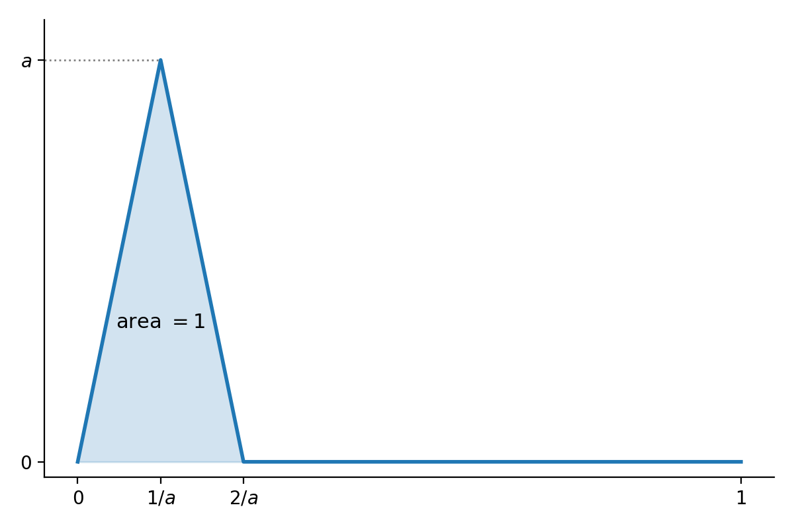

\newcommand{\R}{\mathbf{R}}
\newcommand{\C}{\mathbf{C}}
\newcommand{\supnorm}[1]{\|#1\|_{\mathrm{sup}}}

The Singular Value Decomposition (SVD) is a version of the spectral theorem that applies to non-square matrices.
Let $X$ be a real $n\times m$ matrix and let $D=X^{\top}X$.  $D$ is a positive semidefinite symmetric $m\times m$ matrix and so we can apply
the spectral theorem to find an orthogonal matrix $P$ such that $P^{\top}DP=\Lambda$ where $\Lambda$ is diagonal.
Put another way:
$$
DP = P\Lambda
$$

which expresses the fact that the columns of $P$ are orthonormal eigenvectors for $D$.

Let's set $A=XP$.  Then $A^{\top}A=P^{\top}X^{\top}XP=\Lambda$.   This means that the columns of $A$ are orthogonal but not necessarily orthonormal. 

From a geometric point of view, the entries of each row of $A$ are the coordinates of the corresponding row of $X$ in the orthonormal basis given by the columns of $P$. 

If $D$ is positive definite, so all the $\lambda_{i}>0$, then we can normalize the columns of $A$ by setting $A_{1}=A\Lambda^{-1/2}$.  This happens if and only if $X$ has rank $m\le n$. 
In this case $A_{1}^{\top}A_{1}=\Lambda^{-1/2}\Lambda\Lambda^{-1/2}=I$.
So $A_{1}$ has orthonormal columns. 

If $D$ has zero eigenvalues, then the matrix $A$ will have zero columns corresponding to the zero eigenvalues. So let's order the eigenvalues in descending order of size and suppose $\lambda_{r+1},\ldots, \lambda_{m}$ are all zero.  In this case, the rank of $X$ is $r$. Drop columns $r+1,\ldots, m$ from $A$, yielding $A_{r}$, and "shrink" $\Lambda$ so that it is $r\times r$
with the nonzero eigenvalues on the diagonal, yielding $\Lambda_{r}$.  Let $A_{1}=A_{r}\Lambda_{r}^{-1/2}$ as before. This $A_{1}$ is $n\times r$ and has orthonormal
columns. 

Complete the columns of $A_{1}$ to obtain an orthogonal $n\times n$ matrix $U$ by adding orthonormal columns $u_{r+1},\ldots, u_{n}$.
Let $\sigma_{i}=\sqrt{\lambda_{i}}$ for $i=1,\ldots,m$ and let $\Sigma$ be the $n\times m$ "diagonal" matrix constructed from these "singular values."

The key point now is that, in the product $U\Sigma$, the first $r$ columns are multiplied by the nonzero $\sqrt{\lambda_{i}}$, so 
the first $r$ columns of $U\Sigma$ give the matrix $A_{1}\Lambda_{r}^{1/2}$, which agrees with the first $r$ columns of $A=XP$. 
The remaining columns of $U\Sigma$ are zero, which agrees with the remaining columns of $A=XP$.  

Therefore:
$$
XP = U\Sigma
$$

or $X=U\Sigma V^{\top}$ where $U$ is orthogonal, $\Sigma$ is $n\times m$ "diagonal", and $V=P$ is $m\times m$ orthogonal. This is called the *singular value decomposition* of $X$.  The diagonal entries of $\Sigma$ are called the singular values and are uniquely determined. 

The "reduced" form of this decomposition keeps only the first $r$ columns of $U$, leaving an $n\times r$ matrix $U_{r}$; the first $r$ diagonal entries of $\Sigma$, leaving an $r\times r$ diagonal matrix $\Sigma_{r}$; and the first $r$ columns of $P$, yielding an $m\times r$ matrix $V_{r}$.   Then
$$
X = U_{r}\Sigma_{r}V_{r}^{\top}.
$$

## Low Rank Approximations

One way to interpret the singular value decomposition is that it allows one to write a linear transformation $L:\R^m\to\R^n$ as a sum of rank
one maps.  This follows from the fact that, if we let $X$ be the matrix of $L$, then the reduced SVD tells us that
$$
X = \sum_{i=1}^{r} \sigma_{i}u_{i}v_{i}^{\top}.
$$

Here the $u_{i}$ and $v_{i}$ are the columns of $U$ and $V$ respectively and the $\sigma_{i}$ are the singular values. 
Each $u_{i}v_{i}^{\top}$ is an $(n\times 1) \times (1\times m)$ matrix product, yielding an $n\times m$ matrix. It is rank one
since its range is spanned by $u_{i}$.

Now consider the matrices obtained by truncating this sum:
$$
X_{k} = \sum_{i=1}^{k} \sigma_{i}u_{i}v_{i}^{\top}
$$

Here (assuming the $\sigma_{i}>0$ for $i\le k$), $X_{k}$ has rank $k$.  We will show that $X_{k}$ is the best approximation to the original matrix $X$ among all matrices of rank at most $k$ (and, after choosing orthonormal bases, the same holds for linear maps between inner product spaces). We will look at a variety of characterizations of "best," but for many applications the most useful one is that $X_{k}$ minimizes the squared error between the original $X=(x_{ij})$ and
matrices $B=(b_{ij})$ of rank at most $k$:
$$
E(B,X) =\sum_{i,j} (x_{ij}-b_{ij})^2.
$$

### Application: Image Compression

One application of the technique of "low-rank approximation" is to the problem of image compression.  A gray-scale image is basically an array of integers where each cell of the array corresponds to a pixel in the image, and the value represents how that pixel should be drawn ($0$ for black, $255$ for white).  A color image is generally represented by three arrays, with the color of each pixel represented by a 3-tuple giving the
red, green, and blue intensity of that pixel.

We consider the gray-scale case for simplicity.  Suppose $A$ is a matrix representing an $n\times n$ image, consisting of $n^{2}$
integers between $0$ and $255$.  As $k$ increases, the rank $k$ approximations $A_{k}$ get close to $A$ and so represent "nearly" the same image.
However, notice that storing $A$ requires $n^{2}$ numbers while storing $A_{k}$ requires $2kn+k=k(2n+1)$.

For example, the following image, taken from the `scipy.datasets` package, is a $512\times 512$ gray-scale image represented by 
a $512\times 512$ matrix $A$ of integers between $0$ and $255$.

{width=60%}

We can compute the SVD of $A=U\Sigma V^{\top}$ where $U$ and $V$ are $512\times 512$ orthogonal matrices and $\Sigma$ is the diagonal
matrix of singular values of $A$.  The largest of these is around $45500$ while the smallest is $.15$.  To see them more clearly,
we plot them here on a logarithmic scale.

{width=70%}

As you can see, there are a relatively small number of "big ones" larger than $10^3$; then many between $10^3$ and $1$; and then a few more on the tail that are less than $1$.

This figure shows the effect of low rank approximation on the image.

{width=100%}

## Norms on Vectors, Matrices and Linear Maps

Our discussion in this section follows, in part,  Conrad's expository note [Computing the Norm of a Matrix](https://kconrad.math.uconn.edu/blurbs/linmultialg/matrixnorm.pdf)

### Vector Space Norms

Let $V$ be a vector space over $F$, where $F$ is either $\R$ or $\C$.  A norm on $V$
is a function $\|\cdot\|:V\to \R$ such that:

- $\|v\|\ge 0$ for all $v\in V$, with equality if and only if $v=0$. 
- $\|v+w\|\le \|v\|+\|w\|$ for all $v,w\in V$.
- $\|cv\|=|c|\|v\|$ for $c\in F$ and $v\in V$.

A function satisfying all these conditions except the requirement that $\|v\|=0$ only if $v=0$ is called a seminorm.

These properties guarantee that the  function $d(v,w)=\|v-w\|$ satisfies the definition of a *metric* on $V$.

There are two key examples of such norms.

1. The "sup" norm relative to a basis.   Choose a basis $e_{1},\ldots, e_{n}$ for $V$.  Then define
$$
\|\sum_{i=1}^{n} a_{i}e_{i}\|_{\mathrm{sup}} = \sup\{|a_1|,\ldots, |a_{n}|\}.
$$

2. The "Euclidean" norm or $\ell^{2}$ norm defined by an inner product $\langle \cdot,\cdot\rangle$:

$$
\|v\| = \sqrt{\langle v,v\rangle}.
$$

The fact that this satisfies the triangle inequality is a consequence of the Cauchy--Schwarz inequality (proved [here](../Week5-6/W05.1.qmd#cauchy-schwarz) for real vector spaces):

$$
|\langle v,w\rangle|\le \sqrt{\langle v,v\rangle \langle w,w\rangle}.
$$

Explicitly, 
$$\begin{aligned}
\|v+w\|^2&=\langle v+w, v+w\rangle \\
 &= \langle v,v\rangle +2\mathrm{Re}\langle v,w\rangle +\langle w,w\rangle \\
&\le \|v\|^2+2|\langle v,w\rangle| +\|w\|^2 \\
&\le \|v\|^2 + 2\|v\|\|w\| + \|w\|^2\  \quad\text{(by Cauchy--Schwarz)}\\
&= (\|v\|+\|w\|)^2
\end{aligned}
$$
and taking the square root of both sides gives the triangle inequality. 

If the inner product is the usual dot product, then the $\ell^{2}$ norm gives the  Euclidean distance. 

**Definition:** Two norms $\|\cdot\|_1$ and $\|\cdot\|_{2}$ on a vector space are *equivalent* if they are each bounded by a constant multiple of the other.  In other words, the two norms are equivalent if there are constants $A>0$ and $B>0$ such that
$$
A\|v\|_{1}\le \|v\|_{2}\le B\|v\|_{1}
$$
for all $v\in V$. 

In fact, on a finite dimensional vector space $V$ over $\R$ or $\C$, all norms on $V$ are equivalent.  

**Proposition:** All norms on $V=\R^{n}$ or $\C^{n}$ are equivalent.

To prove this, we will show that any norm is in fact equivalent to the sup norm for the standard basis.  Let $\rho:V\to\R$ 
be any norm.  Let $e_{1},\ldots, e_{n}$ be the standard basis of $V$.  Then if $v=\sum_{i=1}^{n} a_{i}e_{i}$, we have

$$\begin{aligned}
\rho(v) &= \rho(\sum_{i=1}^{n} a_{i}e_{i}) \\
&\le \sum_{i=1}^{n} |a_{i}|\rho(e_{i}) \\
&\le (\sum_{i=1}^{n}\rho(e_{i}))\|v\|_{\mathrm{sup}}
\end{aligned}
$$

Therefore $\rho(v)\le B\|v\|_{\mathrm{sup}}$ with $B=\sum_{i=1}^{n}\rho(e_{i})$. 

**Lemma:** The norm $\rho$ is a continuous function in the metric topology given by $\supnorm{\cdot}$.

**Proof:** Given $\epsilon>0$, we need to find $\delta$ so that $\supnorm{x-y}<\delta$ implies $|\rho(x)-\rho(y)|<\epsilon$.
By the triangle inequality, $|\rho(x)-\rho(y)|\le\rho(x-y)\le B\supnorm{x-y}$, so we can take $\delta=\epsilon/B$ (any $\delta$ works if $B=0$).

**Remark:** The proof so far works when $\rho$ is only a seminorm, not just a norm, but the next part needs $\rho(v)=0$ only when $v=0$. 

**Lemma:** The unit sphere $\{v : \supnorm{v}= 1\}$ in $V$ is compact.

**Proof:**  The unit ball $\{v:\supnorm{v}\le 1\}$ is compact, since it is either a finite product of copies of the
interval $[-1,1]$ in the real case, or a finite product of copies of the closed disk $\{|z|\le 1\}$ in the complex case.
The open ball $\{v: \supnorm{v}<1\}$ is a finite product of open intervals, or open disks, so it's open. The sphere is the complement
of the open ball in the closed ball, so it's closed; as a closed subset of a compact set, it is compact.

Now consider the norm as a function on the unit sphere. As a continuous function on a compact set, it attains its minimum $A$.
And since $\rho$ is nonzero on the unit sphere, $A>0$.  It follows that, for $v\neq 0$,
$$
\rho(\frac{v}{\supnorm{v}})\ge A
$$
and therefore
$$
\rho(v)\ge A\supnorm{v}.
$$

Putting it all together we get
$$
A\supnorm{v}\le \rho(v)\le B\supnorm{v}.
$$
as desired. 

**Remark:** The key part of this result is the compactness of the closed intervals in $\R$ or closed disks in $\C$; these
follow in general from the "Heine-Borel" theorem which says that closed and bounded subsets of $\R^{n}$ are compact. In
[Equivalence of Norms](http://kconrad.math.uconn.edu/blurbs/gradnumthy/equivnorms.pdf) Conrad describes the proof of 
a more general result that all norms on a finite dimensional vector space over a complete valued field (meaning a complete field together with a choice of norm that induces the complete topology) are equivalent.

**Corollary:** Let $V$ and $W$ be  finite dimensional vector spaces (over $\R$ or $\C$). Then all linear maps from $V$ to $W$
are continuous in any norm topology.  A set which is bounded in one norm is bounded in any norm; similarly for open, closed,
or compact.   

### The infinite dimensional case is different

It is very definitely *false* that all norms on an infinite dimensional real or complex vector space
are equivalent.

For example, consider the space 
$C([0,1])$ of continuous functions on the interval $[0,1]$.  Define two norms on this space.  The first
is the "sup norm":
$$
\|f\| = \sup_{0\le x\le 1} |f(x)|
$$
and the second is the $L^{1}$ norm:
$$
\|f\| = \int_{0}^{1} |f(x)|dx.
$$

Notice that we can find a continuous function whose sup-norm is arbitrarily large, while its $L^{1}$ norm remains one, by looking at a function with a big "spike" but total area 1 as shown here.

{width=70%}

## Matrix Norms

Now we turn to norms on matrices and linear maps.  The first thing to observe is that the space $M_{n\times m}(F)$ of $n\times m$ matrices over $F=\R$ or $F=\C$ is a copy of $F^{nm}$. Thus we have  the supnorm $\supnorm{\cdot}$ and the $\ell^{2}$ or Euclidean
norm  $\|\cdot\|$ on matrices, and all norms on the space of matrices are equivalent.

Let's focus on the case of linear maps $L:F^{n}\to F^{n}$ where $F=\R$ or $F=\C$.  Equivalently, we work with 
square matrices $A\in M_{n}(F)$. Write $\rho_{A}(v)=\|Av\|$. In general,
the function $\rho_{A}(v)=\|Av\|$ (here $\|\cdot\|$ is the $\ell^{2}$ norm in the standard basis of $F^{n}$)
is a seminorm on $F^{n}$.  Indeed:

- $\rho_{A}(v)=\|A(v)\|\ge 0$.
- $\rho_{A}(v+w)=\|A(v+w)\| = \|A(v)+A(w)\|\le \|A(v)\|+\|A(w)\| = \rho_{A}(v)+\rho_{A}(w)$
- $\rho_{A}(av) = \|A(av)\| = \|aA(v)\|=|a|\|A(v)\|= |a|\rho_{A}(v)$.

As we pointed out above, this means that
$\rho_{A}$ is a continuous function and there is a constant $C\ge 0$ such that
$$
\rho_{A}(v)\le C\|v\|
$$
for all $v$.  

**Proposition:** There is a unique real number $b\ge 0$ such that $\rho_{A}(v)\le b\|v\|$ for all $v$, and, $b$ is minimal with this property.  

**Proof:** Our estimate above shows that $\rho_{A}$ is bounded on the sphere $\{v: \|v\|=1\}$, which, as we saw above, is compact.
Therefore $\rho_{A}$ attains its maximum and we set $b$ to be this maximum.

**Definition:** The operator norm $\|A\|$ of $A$ is the number $b$ defined as the maximum 
$$
\|A\| = \sup_{v: \|v\|=1} \|A(v)\|
$$

**Proposition:**  The operator norm is in fact a norm on $M_{n}(F)$ when $F=\R$ or $F=\C$.  Further, if $B\in M_{n}(F)$, then:

- $\|AB\|\le \|A\|\|B\|$
- $\|A^{*}\|=\|A\|$
- $\|A^{*}A\|=\|AA^{*}\| = \|A\|^2$ and therefore $\|A\|=\sqrt{\|A^{*}A\|}=\sqrt{\|AA^{*}\|}$
- $|\langle Av, w\rangle|\le \|A\|\|v\|\|w\|$
- The operator norm is equivalent to the sup norm on $M_{n}(F)$ with
$$
\supnorm{A}\le \|A\|\le n\sqrt{n}\supnorm{A}.
$$

In particular the operator norm gives $M_{n}(F)$ the topology of $F^{n^{2}}$, so $M_{n}(F)$ is complete relative to the operator norm (Cauchy sequences relative to the operator norm converge).

**Proof:** This is Theorem 3.4 of [Computing the Norm of a Matrix](https://kconrad.math.uconn.edu/blurbs/linmultialg/matrixnorm.pdf)
To check a few, first notice that:
$$
\|ABv\|\le \|A\|\|Bv\|\le \|A\|\|B\|\|v\|
$$
Since $\|AB\|$ is the smallest $C$ such that $\|(AB)v\|\le C\|v\|$ we have $\|AB\|\le \|A\|\|B\|$.

The relationship with the adjoint $A^{*}$ (the conjugate transpose, which is just $A^{\top}$ when $F=\R$) is more interesting. We have
$$
\|Av\|^2 = \langle Av, Av\rangle = \langle v, A^{*}Av\rangle \le \|v\|\|A^{*}Av\|
$$
by the Cauchy--Schwarz inequality. This tells us that
$$
\|A\|^2\le \|A^{*}A\|\le \|A^{*}\|\|A\|
$$
The result we seek is obvious if $A=0$.  If $A$ is not zero, divide both sides by $\|A\|$ to get
$$
\|A\|\le \|A^{*}\|.
$$

Applying this to $A^{*}$ in place of $A$ (and using $(A^{*})^{*}=A$) gives
$$
\|A^{*}\|\le \|A\|
$$

so they are equal.  But then
$$
\|A\|^2\le \|A^{*}A\|\le \|A^{*}\|\|A\|\le \|A\|^2
$$

so $\|A\|^{2}=\|A^{*}A\|$ and similarly $\|A\|^{2}=\|AA^{*}\|$.

Also, $|\langle Av, w\rangle|\le \|Av\|\|w\|\le \|A\|\|v\|\|w\|$ from the Cauchy--Schwarz inequality.

**Proposition:** If $A=A^{*}$ then
$$
\|A\| = \max_{\|v\|=1} |\langle Av, v\rangle| = \max \{|\lambda|\}
$$
where the max is over the set of eigenvalues of $A$. 

**Proof:** One direction is proved above:
$$
|\langle Av, v\rangle|\le \|A\|\|v\|^2\le \|A\|
$$
when $\|v\|=1$.  For the other direction, consider the function
$R:\F^{n}-\{0\}\to \R$:
$$
R(v) = \frac{|\langle Av, v\rangle|}{\|v\|^2}
$$
This function is called the "Rayleigh Quotient" for the map $A$.
It is a continuous function of $v$, and since the unit sphere
$\|v\|=1$ is compact, it attains a maximum on that sphere. Let $m>0$
be that maximum.  Since the Rayleigh quotient $R$ is scale invariant in $v$,
we have
$$
R(v)\ge m
$$
for all nonzero $v$.  In other words
$$
$|\langle Av, v\rangle| \le m \|v\|^2
$$
for all nonzero $v$.  Since it's also true when $v=0$, it's true on all
of $\F^{n}$. 

Now given $v,w\in\F^{n}$, we have the "polarization identity":
$$
\langle A(v+w),v+w\rangle -\langle A(v-w),v-w\rangle = 2(\langle Av,w\rangle
+\langle Aw,v \rangle) = 4\langle Av,w\rangle 
$$
where we have used that $A=A^{*}$.  Thus
$$
4|\langle Av, w\rangle \le m(\|v+w\|^2 + \|v-w\|^2).
$$
But 
$$
\|v+w\|^2 + \|v-w\|^2 = 2(\|v\|^2+\|w\|^2).
$$

so, for all $v,w$ we have: 

$$
\|\langle Av,w\rangle\| \le m\|v\|\|w\|
$$

If $w=Av$, this implies
$$
|\langle Av, Av\rangle| =\|Av\|^2 \le m\|v\|\|Av\|
$$

so, finally,

$$
\|Av\|\le m\|v\|
$$
which means $\|A\|\le m$ and, combined with our earlier estimate,
that $\|A\|=m$. 

Now suppose that $u$ is a unit vector such that $\langle Au,u\rangle=\|A\|$. 
Let $\alpha=\|A\|$.  Consider
$$
\|Au-\alpha u\|^2 = \|Au\|^2-2\alpha (Au,u)+\alpha^2 =\|Au\|^2-\alpha^2
$$

using $A=A*$ as usual.  Since $\|Au\|^2\le \|A\|^2$, we have

$$
0 \le \|Au-\alpha u\|^2 \le \|A\|^2-\alpha^2 = 0
$$
so 
$$
Au=\alpha u
$$

Thus $\|A\|$ is an eigenvalue of $A$, and it must be the largest such.

**Corollary:** Let $A$ be any $n\times n$ matrix.  Then $\|A\|$ is
the largest singular value of $A$.

**Proof:** We know that $\|A\|^2 = \|A^*A\|$.