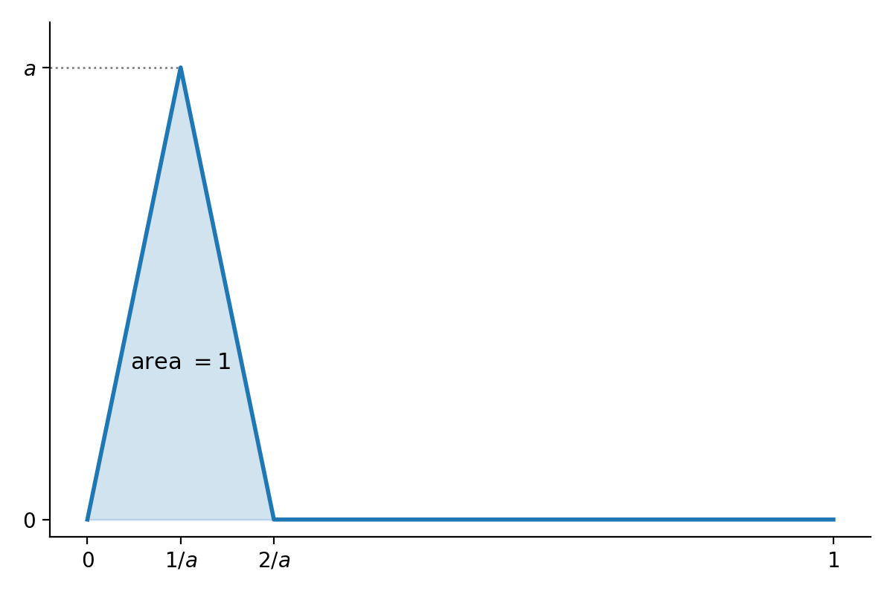

\newcommand{\R}{\mathbf{R}}
\newcommand{\C}{\mathbf{C}}
\newcommand{\supnorm}[1]{\|#1\|_{\mathrm{sup}}}
\newcommand{\frobnorm}[1]{\|#1\|_{F}}
\newcommand{\re}{\operatorname{Re}}
\newcommand{\trace}[1]{\mathrm{trace}(#1)}

The Singular Value Decomposition (SVD) is a version of the spectral theorem that applies to non-square matrices.
Let $X$ be an  $n\times m$ matrix over $F$, where $F=\R$ or $\C$, and let $D=X^{*}X$.  $D$ is a positive semidefinite hermitian  $m\times m$ matrix and so we can apply
the spectral theorem to find a unitary matrix $P$ such that $P^{*}DP=\Lambda$ where $\Lambda$ is diagonal with entries $\Lambda_{ii}=\lambda_{i}$. The $\lambda_{i}$ are nonnegative real numbers. 

Put another way:
$$
DP = P\Lambda
$$

which expresses the fact that the columns of $P$ are orthonormal eigenvectors for $D$.

Let's set $A=XP$.  Then $A^{*}A=P^{*}X^{*}XP=\Lambda$.   This means that the columns of $A$ are orthogonal but not necessarily orthonormal. 

If $F=\R$, then from a geometric point of view, the entries of each row of $A$ are the coordinates of the corresponding row of $X$ in the orthonormal basis given by the columns of $P$. 

If $D$ is positive definite, so all the $\lambda_{i}>0$, then we can normalize the columns of $A$ by setting $A_{1}=A\Lambda^{-1/2}$.  This happens if and only if $X$ has rank $m$ (which forces $m\le n$).
In this case $A_{1}^{*}A_{1}=\Lambda^{-1/2}\Lambda\Lambda^{-1/2}=I$.
So $A_{1}$ has orthonormal columns. 

If $D$ has zero eigenvalues, then the matrix $A$ will have zero columns corresponding to the zero eigenvalues. So let's rearrange things to order the eigenvalues in descending order of size and suppose $\lambda_{r+1},\ldots, \lambda_{m}$ are all zero.  In this case, the rank of $X$ is $r$. Drop columns $r+1,\ldots, m$ from $A$, yielding $A_{r}$, and "shrink" $\Lambda$ so that it is $r\times r$
with the nonzero eigenvalues on the diagonal, yielding $\Lambda_{r}$.  Let $A_{1}=A_{r}\Lambda_{r}^{-1/2}$ as before. This $A_{1}$ is $n\times r$ and has orthonormal
columns. 

Complete the columns of $A_{1}$ to obtain a unitary $n\times n$ matrix $U$ by adding orthonormal columns $u_{r+1},\ldots, u_{n}$.
Let $\sigma_{i}=\sqrt{\lambda_{i}}$ for $i=1,\ldots,m$ and let $\Sigma$ be the $n\times m$ "diagonal" matrix constructed from these "singular values." (If $n<m$, then only $n$ elements will "fit" in the diagonal of $\Sigma$.  In that case  $\sigma_{i}=0$ for $n<i\le m$ and we just drop these zeros.) 

The key point now is that, in the product $U\Sigma$, the first $r$ columns are multiplied by the nonzero $\sqrt{\lambda_{i}}$, so 
the first $r$ columns of $U\Sigma$ give the matrix $A_{1}\Lambda_{r}^{1/2}$, which agrees with the first $r$ columns of $A=XP$. 
The remaining columns of $U\Sigma$ are zero, which agrees with the remaining columns of $A=XP$.  

Therefore:
$$
XP = U\Sigma
$$

or $X=U\Sigma V^{*}$ where $U$ is unitary, $\Sigma$ is $n\times m$ "diagonal" with non-negative real entries, and $V=P$ is $m\times m$ unitary. This is called the *singular value decomposition* of $X$.  The diagonal entries of $\Sigma$ are called the singular values and the set of singular values
is uniquely determined. 

The "reduced" form of this decomposition keeps only the first $r$ columns of $U$, leaving an $n\times r$ matrix $U_{r}$; the first $r$ diagonal entries of $\Sigma$, leaving an $r\times r$ diagonal matrix $\Sigma_{r}$; and the first $r$ columns of $V$, yielding an $m\times r$ matrix $V_{r}$.   Then
$$
X = U_{r}\Sigma_{r}V_{r}^{*}.
$$

## Low Rank Approximation -- Overview

One way to interpret the singular value decomposition is that it allows one to write a linear transformation $L:F^m\to F^n$ as a sum of rank-one maps.  This follows from the fact that, if we let $X$ be the matrix of $L$, then the reduced SVD tells us that
$$
X = \sum_{i=1}^{r} \sigma_{i}u_{i}v_{i}^{*}.
$$

Here the $u_{i}$ and $v_{i}$ are the columns of $U$ and $V$ respectively and the $\sigma_{i}$ are the singular values. 
Each $u_{i}v_{i}^{*}$ is an $(n\times 1) \times (1\times m)$ matrix product, yielding an $n\times m$ matrix. It is rank one
since its range is spanned by $u_{i}$.

Now consider the matrices obtained by truncating this sum (where as usual the $\sigma_{i}$ are in descending order):
$$
X_{k} = \sum_{i=1}^{k} \sigma_{i}u_{i}v_{i}^{*}.
$$

Here (assuming the $\sigma_{i}>0$ for $i\le k$), $X_{k}$ has rank $k$.  We will show that $X_{k}$ is a  best approximation to the original matrix $X$ among all matrices of rank at most $k$ (and, after choosing orthonormal bases, the same holds for linear maps between inner product spaces). We will look at a variety of characterizations of "best," but for many applications the most useful one is that $X_{k}$ minimizes the squared error between the original $X=(x_{ij})$ and
matrices $B=(b_{ij})$ of rank at most $k$:
$$
\frobnorm{X-B}^2 =\sum_{i,j} |x_{ij}-b_{ij}|^2.
$$

### Application: Image Compression

One application of the technique of "low-rank approximation" is to the problem of image compression.  A gray-scale image is basically an array of integers where each cell of the array corresponds to a pixel in the image, and the value represents how that pixel should be drawn ($0$ for black, $255$ for white).  A color image is generally represented by three arrays, with the color of each pixel represented by a 3-tuple giving the
red, green, and blue intensity of that pixel.

We consider the gray-scale case for simplicity.  Suppose $A$ is a matrix representing an $n\times n$ image, consisting of $n^{2}$
integers between $0$ and $255$.  As $k$ increases, the rank-$k$ approximations $A_{k}$ get closer to $A$ and so represent "nearly" the same image.
However, notice that storing $A$ requires $n^{2}$ numbers while storing $A_{k}$ requires $2kn+k=k(2n+1)$.  For $k$ small relative to $n$ this is a considerable savings. 

For example, the following image, taken from the `scipy.datasets` package, is a $512\times 512$ gray-scale image represented by 
a $512\times 512$ matrix $A$ of integers between $0$ and $255$.

{width=60%}

We can compute the SVD  $U\Sigma V^{\top}$ of $A$ where $U$ and $V$ are $512\times 512$ orthogonal matrices and $\Sigma$ is the diagonal
matrix of singular values of $A$.  The largest of these is around $45500$ while the smallest is $0.15$.  To see them more clearly,
we plot them here on a logarithmic scale.

{width=70%}

As you can see, there is a relatively small number of "big ones" larger than $10^3$; then many between $10^3$ and $1$; and then a few more on the tail that are less than $1$.

This figure shows the effect of low-rank approximation on the image.

{width=100%}

## Norms on Vectors, Matrices and Linear Maps

Our discussion in this section follows, in part,  Conrad's expository note [Computing the Norm of a Matrix](https://kconrad.math.uconn.edu/blurbs/linmultialg/matrixnorm.pdf).

### Vector Space Norms

Let $V$ be a vector space over $F$, where $F$ is either $\R$ or $\C$.  A norm on $V$
is a function $\|\cdot\|:V\to \R$ such that:

- $\|v\|\ge 0$ for all $v\in V$, with equality if and only if $v=0$. 
- $\|v+w\|\le \|v\|+\|w\|$ for all $v,w\in V$.
- $\|cv\|=|c|\|v\|$ for all $c\in F$ and $v\in V$.

A function satisfying all these conditions except the requirement that $\|v\|=0$ only if $v=0$ is called a seminorm.

These properties guarantee that the  function $d(v,w)=\|v-w\|$ satisfies the definition of a *metric* on $V$.

There are two key examples of such norms.

1. The "sup" norm relative to a basis.   Choose a basis $e_{1},\ldots, e_{n}$ for $V$.  Then define
$$
\left\|\sum_{i=1}^{n} a_{i}e_{i}\right\|_{\mathrm{sup}} =\sup\{|a_1|,\ldots, |a_{n}|\}.
$$

2. The "Euclidean" norm or $\ell^{2}$ norm defined by an inner product $\langle \cdot,\cdot\rangle$:

$$
\|v\| = \sqrt{\langle v,v\rangle}.
$$

The fact that this satisfies the triangle inequality is a consequence of the Cauchy--Schwarz inequality (proved [here](../Week5-6/W05.1.qmd#cauchy-schwarz) for real vector spaces):

$$
|\langle v,w\rangle|\le \sqrt{\langle v,v\rangle \langle w,w\rangle}.
$$

Explicitly, 
$$\begin{aligned}
\|v+w\|^2&=\langle v+w, v+w\rangle \\
 &= \langle v,v\rangle +2\re\langle v,w\rangle +\langle w,w\rangle \\
&\le \|v\|^2+2|\langle v,w\rangle| +\|w\|^2 \\
&\le \|v\|^2 + 2\|v\|\|w\| + \|w\|^2 \quad\text{(by Cauchy--Schwarz)}\\
&= (\|v\|+\|w\|)^2
\end{aligned}
$$
and taking the square root of both sides gives the triangle inequality. 

If the inner product is the usual dot product, then the $\ell^{2}$ norm gives the  Euclidean distance. 

**Definition:** Two norms $\|\cdot\|_a$ and $\|\cdot\|_{b}$ on a vector space $V$ are *equivalent* if they are each bounded by a constant multiple of the other.  In other words, the two norms are equivalent if there are constants $A>0$ and $B>0$ such that
$$
A\|v\|_{a}\le \|v\|_{b}\le B\|v\|_{a}
$$
for all $v\in V$. 

In fact, on a finite-dimensional vector space $V$ over $\R$ or $\C$, all norms on $V$ are equivalent.  

**Proposition:** All norms on a finite-dimensional vector space $V$ over $\R$ or $\C$ are equivalent.

**Proof:** Choose a basis $e_1,\ldots, e_n$ for $V$
and let 
$$
\supnorm{\sum_{i=1}^{n} a_{i}e_{i}} = \sup_{i}\{|a_{i}|\}.
$$

Now let $\rho$ be any other norm on $V$.     
Then if $v=\sum_{i=1}^{n} a_{i}e_{i}$, we have

$$\begin{aligned}
\rho(v) &= \rho\left(\sum_{i=1}^{n} a_{i}e_{i}\right) \\
&\le \sum_{i=1}^{n} |a_{i}|\rho(e_{i}) \\
&\le \left(\sum_{i=1}^{n}\rho(e_{i})\right)\supnorm{v}
\end{aligned}
$$ 164549 

Therefore $\rho(v)\le B\supnorm{v}$ with $B=\sum_{i=1}^{n}\rho(e_{i})$. 

**Lemma:** The norm $\rho$ is a continuous function in the metric topology given by $\supnorm{\cdot}$.

**Proof:** Given $\epsilon>0$, we need to find $\delta$ so that $\supnorm{x-y}<\delta$ implies $|\rho(x)-\rho(y)|<\epsilon$.
By the triangle inequality, $|\rho(x)-\rho(y)|\le\rho(x-y)\le B\supnorm{x-y}$, so we can take $\delta=\epsilon/B$ (any $\delta$ works if $B=0$).

**Remark:** The proof so far works even when $\rho$ is only a seminorm, not just a norm, but the next part needs $\rho(v)=0$ only when $v=0$. 

**Lemma:** The unit sphere $\{v : \supnorm{v}= 1\}$ in $V$ is compact.

**Proof:**  The unit ball $\{v:\supnorm{v}\le 1\}$ is compact, since it is either a finite product of copies of the
interval $[-1,1]$ in the real case, or a finite product of copies of the closed disk $\{|z|\le 1\}$ in the complex case.
The open ball $\{v: \supnorm{v}<1\}$ is a finite product of open intervals, or open disks, so it's open. The sphere is the complement
of the open ball in the closed ball, so it's closed; as a closed subset of a compact set, it is compact.

Now consider the norm as a function on the unit sphere. As a continuous function on a compact set, it attains its minimum $A$.
And since $\rho$ is nonzero on the unit sphere, $A>0$.  It follows that, for $v\neq 0$,
$$
\rho\left(\frac{v}{\supnorm{v}}\right)\ge A
$$
and therefore
$$
\rho(v)\ge A\supnorm{v}.
$$

Putting it all together we get
$$
A\supnorm{v}\le \rho(v)\le B\supnorm{v}
$$
as desired. 

**Remark:** The key part of this result is the compactness of the closed intervals in $\R$ or closed disks in $\C$; these
follow in general from the "Heine--Borel" theorem which says that closed and bounded subsets of $\R^{n}$ are compact. In
[Equivalence of Norms](https://kconrad.math.uconn.edu/blurbs/gradnumthy/equivnorms.pdf) Conrad describes the proof of 
a more general result that all norms on a finite-dimensional vector space over a complete valued field (meaning a  field together with a choice of norm that induces a complete topology) are equivalent.

**Corollary:** Let $V$ and $W$ be finite-dimensional vector spaces (over $\R$ or $\C$). Then all linear maps from $V$ to $W$
are continuous in any norm topology.  A set which is bounded in one norm is bounded in any norm; similarly for open, closed,
or compact.   

### The infinite-dimensional case is different

It is very definitely *false* that all norms on an infinite-dimensional real or complex vector space
are equivalent.

For example, consider the space 
$C([0,1])$ of continuous functions on the interval $[0,1]$.  Define two norms on this space.  The first
is the "sup norm":
$$
\supnorm{f} = \sup_{0\le x\le 1} |f(x)|,
$$
and the second is the $L^{1}$ norm:
$$
\|f\|_{L^{1}}= \int_{0}^{1} |f(x)|\,dx.
$$

Notice that we can find a continuous function whose sup norm is arbitrarily large, while its $L^{1}$ norm remains $1$, by looking at a function with a big "spike" but total area $1$ as shown below.
Therefore there is no constant $B$ such that
$$
\supnorm{f}\le B\|f\|_{L^{1}}
$$
for all $f$, and therefore these two norms aren't equivalent. 

{width=70%}

## Matrix Norms

Now we turn to norms on matrices and linear maps.  The first thing to observe is that the space $M_{n\times m}(F)$ of $n\times m$ matrices over $F=\R$ or $F=\C$ is a copy of $F^{nm}$. Therefore we have  the supnorm $\supnorm{\cdot}$ on matrices. In addition, we have 
the "Frobenius norm" $\frobnorm{\cdot}$ which is just the  $\ell^{2}$ or Euclidean
norm.   Our earlier work on equivalence of norms applies and therefore  all norms on the space of matrices are equivalent.

### The operator norm

Let's focus on the case of linear maps $L:F^{m}\to F^{n}$ where $F=\R$ or $F=\C$.  Equivalently, we work with 
 matrices $A\in M_{n\times m}(F)$. Write $\rho_{A}(v)=\|Av\|$. In general,
the function $\rho_{A}(v)=\|Av\|$ is a seminorm on $F^{m}$. Note that here $\|v\|$ is the $\ell^{2}$ norm of $v\in F^{m}$ while $\|Av\|$ is the $\ell^{2}$ norm of $Av$ on $F^{n}$). 
Then:

- $\rho_{A}(v)=\|A(v)\|\ge 0$.
- $\rho_{A}(v+w)=\|A(v+w)\| = \|A(v)+A(w)\|\le \|A(v)\|+\|A(w)\| = \rho_{A}(v)+\rho_{A}(w)$
- $\rho_{A}(av) = \|A(av)\| = \|aA(v)\|=|a|\|A(v)\|= |a|\rho_{A}(v)$.

As we pointed out above, this means that
$\rho_{A}$ is a continuous function and there is a constant $C\ge 0$ such that
$$
\rho_{A}(v)\le C\|v\|
$$
for all $v$.  

**Proposition:** There is a smallest real number $b\ge 0$ such that $\rho_{A}(v)\le b\|v\|$ for all $v$. 

**Proof:** 
The sphere $\{v\in F^{m}: \|v\|=1\}$  is closed and bounded, hence compact. 
Since $\rho_{A}$ is continuous,
it attains its maximum and we set $b$ to be this maximum.
Then
$$
\rho_{A}(v/\|v\|)\le b 
$$
so 
$$
\rho_{A}(v)\le b\|v\|
$$
for any $v\not=0$ (and trivially for $v=0$ as well. )

Let $v_{0}$ be the point at which $\rho_{A}(v_{0})=b$.
Then if $\rho_{A}(v)\le c\|v\|$ for all $v$, substituting
$v=v_{0}$ we get
$$
b\le c.
$$

So we have found our $b$. 

**Definition:** The operator norm  $\|A\|$ of $A$ is the number $b$ defined as the maximum 
$$
\|A\| = \max_{v\in F^{m}: \|v\|=1} \|A(v)\|.
$$

**Proposition:**  The operator norm is in fact a norm on $M_{n\times m}(F)$ when $F=\R$ or $F=\C$.  Further, if $B\in M_{m\times p}(F)$, then:

- $\|AB\|\le \|A\|\|B\|$
- $\|A^{*}\|=\|A\|$
- $\|A^{*}A\|=\|AA^{*}\| = \|A\|^2$ and therefore $\|A\|=\sqrt{\|A^{*}A\|}=\sqrt{\|AA^{*}\|}$
- $|\langle Av, w\rangle|\le \|A\|\|v\|\|w\|$ for $v\in F^{m}$, $w\in F^{m}$. 
- The operator norm is equivalent to the sup norm on $M_{n}(F)$ with
$$
\supnorm{A}\le \|A\|\le \sqrt{nm}\supnorm{A}.
$$

In particular the operator norm gives $M_{n\times m}(F)$ the topology of $F^{nm}$, so $M_{n\times m}(F)$ is complete relative to the operator norm (Cauchy sequences relative to the operator norm converge).

**Proof:** This is Theorem 3.4 of [Computing the Norm of a Matrix](https://kconrad.math.uconn.edu/blurbs/linmultialg/matrixnorm.pdf)
To check a few, first notice that:
$$
\|ABv\|\le \|A\|\|Bv\|\le \|A\|\|B\|\|v\|.
$$
Since $\|AB\|$ is the smallest $C$ such that $\|(AB)v\|\le C\|v\|$ for all $v$,  we have $\|AB\|\le \|A\|\|B\|$.

The relationship with the adjoint $A^{*}$ (the conjugate transpose, which is just $A^{\top}$ when $F=\R$) is more interesting. We have
$$
\|Av\|^2 = \langle Av, Av\rangle = \langle v, A^{*}Av\rangle \le \|v\|\|A^{*}Av\|\le \|A^{*}A\|\|v\|^2
$$
by the Cauchy--Schwarz inequality and the definition of the $\|A^{*}A\|$. Taking the maximum over unit vectors $v$,
and using $\|AB\|\le \|A\|\|B\|$, gives
$$
\|A\|^2\le \|A^{*}A\|\le \|A^{*}\|\|A\|.
$$

Clearly $\|A^{*}\|=\|A\|$ if $A=0$.   If $A$ is not zero, divide $\|A\|^2\le \|A^{*}\|\|A\|$ by $\|A\|$ to get
$$
\|A\|\le \|A^{*}\|.
$$

Applying this to $A^{*}$ in place of $A$ (and using $(A^{*})^{*}=A$) gives
$$
\|A^{*}\|\le \|A\|,
$$
so they are equal.  But then
$$
\|A\|^2\le \|A^{*}A\|\le \|A^{*}\|\|A\| = \|A\|^2,
$$
so $\|A\|^{2}=\|A^{*}A\|$. Applying this to $A^{*}$ gives $\|A^{*}\|^{2}=\|AA^{*}\|$, and since $\|A^{*}\|=\|A\|$ we get $\|A\|^{2}=\|AA^{*}\|$.

Also, $|\langle Av, w\rangle|\le \|Av\|\|w\|\le \|A\|\|v\|\|w\|$ by the Cauchy--Schwarz inequality and the definition of $\|A\|$.

**Proposition:** If $n=m$ and $A=A^{*}$, then
$$
\|A\| = \max_{\|v\|=1} |\langle Av, v\rangle| = \max \{|\lambda|\}
$$
where the max is over the set of eigenvalues of $A$. 

**Proof:** We showed above that
$$
|\langle Av, v\rangle|\le \|A\|\|v\|^2\le \|A\|
$$
when $\|v\|=1$.  

Now consider the function
$R:F^{n}\setminus\{0\}\to \R$:
$$
R(v) = \frac{|\langle Av, v\rangle|}{\|v\|^2}.
$$
This function is called the "Rayleigh quotient" for the map $A$.
It is a continuous function of $v$, and since the unit sphere
$\|v\|=1$ is compact, it attains a maximum on that sphere. Let $m\ge 0$
be that maximum.  Since the Rayleigh quotient $R$ is scale invariant in $v$,
we have
$$
R(v)\le  m
$$
for all nonzero $v$.  In other words,
$$
|\langle Av, v\rangle| \le m \|v\|^2
$$
for all nonzero $v$.  Since this is also true when $v=0$, it is true on all
of $F^{n}$.

Since $\|A\|\ge R(v)$ for all nonzero $v$, we also
have $\|A\|\ge m$. 

Now given $v,w\in F^{n}$, we have the "polarization identity":
$$\begin{aligned}
\langle A(v+w),v+w\rangle -\langle A(v-w),v-w\rangle &= 2(\langle Av,w\rangle
+\langle Aw,v \rangle)\\
& = 4\re\langle Av,w\rangle 
\end{aligned}
$$
where we have used that $A=A^{*}$.  Thus
$$
4|\re\langle Av, w\rangle| \le m(\|v+w\|^2 + \|v-w\|^2).
$$
But
$$
\|v+w\|^2 + \|v-w\|^2 = 2(\|v\|^2+\|w\|^2).
$$
If we restrict to unit vectors $v$ and $w$, we have
$$
|\re\langle Av,w\rangle| \le m,
$$
and then, by scaling, that
$$
|\re\langle Av,w\rangle| \le m\|v\|\|w\|
$$
for all $v,w\in F^{n}$.

If $w=Av$, then since $\langle Av,Av\rangle=\|Av\|^2$ is real, we have
$$
|\langle Av, Av\rangle| =\|Av\|^2 \le m\|v\|\|Av\|.
$$
This is trivial if $Av=0$; otherwise, dividing by $\|Av\|$ gives
$$
\|Av\|\le m\|v\|.
$$
This means that $\|A\|\le m$. 
Putting the pieces together gives $\|A\|=m$. 

To conclude, we have to make the connection with eigenvalues. 
Suppose that $u$ is a unit vector such that $|\langle Au,u\rangle|=\|A\|$. 
Let $\alpha=\langle Au,u\rangle = \pm\|A\|$.  Consider
$$
\|Au-\alpha u\|^2 = \|Au\|^2-2\alpha \langle Au,u\rangle+\alpha^2 =\|Au\|^2-\alpha^2,
$$
where we use that
$\alpha$ is real 
and $A=A^{*}$.

Now, since $\|u\|=1$, we know that 
$\|Au\|^2\le \|A\|^2$ and therefore
$$
0 \le \|Au-\alpha u\|^2 \le \|A\|^2-\alpha^2 = 0,
$$
so
$$
Au=\alpha u.
$$

Thus $\pm \|A\|$ is an eigenvalue of $A$. Since
the equation $\|Av\|=|\lambda|\|v\|$ holds for every eigenvalue $\lambda$ and eigenvector $v$, 
every eigenvalue satisfies $|\lambda|\le \|A\|. Therefore  $\|A\|=\max_{i}\{|\lambda_{i}|\}$

**Corollary:** Let $A$ be any $n\times m$ matrix.  Then $\|A\|$ is
the largest singular value of $A$.

**Proof:** We know that $\|A\|^2 = \|A^{*}A\|$. The matrix
$A^{*}A$ is self-adjoint and has nonnegative eigenvalues that are the squares of the singular values of $A$.
The largest such is $\sigma_{1}^2$,
so $\|A\|=\sigma_{1}$.

The fact that $\|A\|$ is the largest singular value of $A$ explains
why the operator norm is also called the spectral norm. 

### The Frobenius Norm

Recall from our introduction that 
the Frobenius norm is just the $\ell^{2}$ norm on the
$nm$-dimensional space $M_{n\times m}(F)$.  If $A=(a_{ij})$ is in this space, then
$$
\frobnorm{A}^2 = \sum |a_{ij}|^2.
$$

**Lemma:** The inner product on $M_{n\times m}(F)$ defined by
$$
\langle (a_{ij}),(b_{ij})\rangle =\sum a_{ij}\overline{b_{ij}}
$$
can be computed as
$$
\langle A,B\rangle = \trace{B^{*}A}.
$$
In particular,
$$
\frobnorm{A}^2 = \trace{A^{*}A}.
$$

**Proof:** This follows from a calculation with the formula for matrix multiplication.

**Proposition:** The Frobenius norm of $A$ is the square root of the sum of the squares
of the singular values $\sigma_{1}\ge \cdots \ge \sigma_{r}$ of $A$:
$$
\frobnorm{A} = \sqrt{\sum_{i=1}^{r} \sigma_{i}^2}.
$$

**Proof:** This follows from the fact that $\trace{A^{*}A}$
is the sum of the eigenvalues of $A^{*}A$, which are the $\sigma_{i}^{2}$ (together with zeros).

From this result we see that the spectral and Frobenius norms are closely related;
the spectral norm considers the largest singular value, while the Frobenius norm considers them all. 

## Low Rank Approximation - Proofs

Now we return to the question of low-rank approximation.  Specifically,
given an $n\times m$ matrix $A$ with entries in $F=\R$ or $F=\C$, we want to
identify a matrix $A_{k}$ of rank at most $k$ solving each of the following problems:

- $\|A-A_{k}\|\le \|A-B\|$ for all $B$ of rank $k$ or less (operator norm);
- $\frobnorm{A-A_{k}}\le \frobnorm{A-B}$ for all $B$ of rank $k$ or less (Frobenius norm).

It turns out that the answer to both questions is the same, and it is the one alluded
to in the overview above.   For this proof we follow the argument laid out
in the Wikipedia article [Low Rank Approximation](https://en.wikipedia.org/wiki/Low-rank_approximation).

Since $A$ and $A^{*}$ have the same rank and the same norm (Frobenius or operator), we replace $A$ by $A^{*}$ if necessary and assume that $n\le m$.   Let
$$
A = U\Sigma V^{*}
$$
be the SVD for $A$ with singular values $\sigma_{1}\ge \sigma_{2}\ge\cdots\ge\sigma_{n}\ge 0$.

  

In preparation for our approximation result,  we prove the following lemmas.

**Lemma A:** For $1\le j\le n$, let $v_1,\ldots, v_{j}$ be the first $j$ columns of $V$ (the first $j$ "right singular vectors").  If $w=\sum_{i=1}^{j} \gamma_{i}v_{i}$ is a unit vector, then 
$$
\|Aw\|\ge \sigma_{j}.
$$

**Proof:**
Note that since the $v_{i}$ are orthonormal, the fact that $\|w\|^2=1$ means
$\sum_{i=1}^{j} |\gamma_{i}|^2=1$.  Now $V^{*}w$ is an $m\times 1$ vector
whose first $j$ entries are the $\gamma_{i}$ and whose remaining entries are zero. 
Then $\Sigma V^{*}w$ is an $n\times 1$ matrix $h$ whose entries are $\sigma_{i}\gamma_{i}$ for $i=1,\ldots, j$ followed by zeros for $i=j+1,\ldots, m$. Finally, since $U$ is unitary, 
$$\begin{aligned}
\|Aw\|^2 &= \|U\Sigma V^{*}w\|^2 \\
&= \|Uh\|^2 \\ 
&= \sum_{i=1}^{j} \sigma_{i}^2|\gamma_{i}|^2 \\
&\ge \min_{i=1}^{j}\{\sigma_{j}^2\}\sum |\gamma_{i}|^2 \\
&\get \sigma_{j}^2.
\end{aligned}
$$

**Lemma B:** Set $\sigma_{i}=0$ for $n<i\le m$. If $v_{j},\ldots, v_{m}$ are the last $m-j+1$ columns 
of $V$, and $w$ is a unit vector in their span, then
$$
\|Aw\|\le \sigma_{j}
$$

**Proof:** The argument is essentially the same as for the previous lemma.

**Proposition:** As before, for $k<n$,  set
$$
A_{k} = \sum_{i=1}^{k} \sigma_{i}u_{i}v_{i}^{*},
$$
where $u_{i}$ and $v_{i}$ are the columns of $U$ and $V$ respectively. Then
$$
\|A-B\|\ge \|A-A_{k}\|=\sigma_{k+1}
$$
for all matrices $B$ of rank at most $k$. 

**Proof:** 

We will construct a unit vector $w$ in the span of $v_{1},\ldots, v_{k+1}$ such that $Bw=0$.
Consider the space $S$ which is the span of the first $k+1$ columns of $V$.  This space is $(k+1)$-dimensional since the columns are orthonormal.  Since $B$ has rank at most $k$, the image  $B(S)\subset F^{n}$ has dimension at most $k$,  and so (by rank--nullity) there must be a nonzero vector $w'$ in $S\cap \ker{B}$.  Normalizing this vector gives  $w$.

Now
$$
\|A-B\|^2\|w\|^2\ge \|(A-B)w\|^2 = \|Aw\|^2 \ge \sigma_{k+1}^2
$$
by our Lemma A with $j=k+1$. 

Since we know that $\|A-A_k\|^2=\sigma_{k+1}^2$, we have our approximation result.

Now let's look at the Frobenius norm.  

We calculate:
$$\begin{aligned}
\frobnorm{A-A_{k}}^2 &= \frobnorm{\sum_{i=k+1}^{n}\sigma_{i}u_{i}v_{i}^{*}}^2\\
&= \sum_{i=k+1}^{n}\sigma_{i}^2.
\end{aligned}
$$

We need to show that 
$$
\frobnorm{A-A_{k}}^2\le \frobnorm{A-B}^2
$$
for any $n\times m$ matrix $B$ of rank at most $k$. 

We first prove the following lemma.

**Lemma:** Suppose that $A=A'+A''$ where $A$, $A'$, and $A''$ are $n\times m$ matrices over $F$. Then for any $i,j\ge 1$
with $i+j-1\le n$,  we have
$$
\sigma_{i+j-1}(A)\le \sigma_{i}(A')+\sigma_{j}(A''). 
$$

**Proof:** Notice that $\sigma_{1}(A-A_{i})=\sigma_{i+1}(A)$ for any $A$ where
$A_{i}$ is the rank $i$ approximation, with $A_{0}=0$.  Therefore
$$\begin{aligned}
\sigma_{i}(A')+\sigma_{j}(A'') &= \sigma_{1}(A'-A'_{i-1}) + \sigma_{1}(A''-A''_{j-1}) \\
&\ge \sigma_{1}(A'+A''-A'_{i-1}-A''_{j-1}) = \sigma_{1}(A-A'_{i-1}-A''_{j-1}),
\end{aligned}
$$
where we have used the triangle inequality for the spectral norm. 

Next notice that the rank of $A'_{i-1}+A''_{j-1}$ is at most $i+j-2$.  This is because, given matrices $R$ and $S$, the  column space of $R+S$ is contained in the sum
of the column spaces of $R$ and $S$. 

Apply the operator norm result we have just established with
$k=i+j-2$ to obtain:
$$
\sigma_{1}(A-A'_{i-1}-A''_{j-1})\ge \sigma_{i+j-1}(A).
$$

This proves the lemma. 

Now apply this lemma to $A=(A-B)+B$ for any $1\le i\le n-k$ and $j=k+1$ where $B$ is an $n\times m$ matrix of rank at most $k$. 

Then
$$
\sigma_{i}(A-B)+\sigma_{k+1}(B)\ge \sigma_{i+k}(A).
$$

But $\sigma_{k+1}(B)=0$ since $B$ has rank at most $k$.  Therefore
$$
\sigma_{i}(A-B)\ge \sigma_{i+k}(A),
$$
and
$$\begin{aligned}
\frobnorm{A-B}^2 &= \sum_{i=1}^{n} \sigma_{i}(A-B)^2 \\
&\ge \sum_{i=1}^{n-k}\sigma_{i+k}(A)^2 \\
&=\sum_{i=k+1}^{n}\sigma_{i}(A)^2 \\
&=\frobnorm{A-A_{k}}^2.
\end{aligned}
$$

This gives us the approximation result for the Frobenius norm. 

### The Courant minimax principle

The Courant minimax principle is an elegant way to express the
singular values of $A$.

**Proposition:** For $1\le k\le n$ and subspaces $S$ and $T$ in $F^{m}$ we have:
$$
\sigma_{k}(A) = \max_{\dim{S}=k} \min_{\substack{u\in S}{\|v\|=1}}\|Au\|
$$
and
$$
\sigma_{k}(A) = \min_{\dim{T}=m-k+1}\max_{\substack{ u\in T}{\|u\|=1}} \|Au\|
$$

**Proof:** For the first claim, let $S$ be the span
of $v_{1},\ldots, v_{k}$.  Then by Lemma A, 
$$
\min_{\substack{v\in S}{\|v\|=1}} \|Av\| \ge  \sigma_{k}.
$$
This proves that
$$
\max_{\dim(S)=k}\min_{\substack{v}\in S}{\v\|=1} \|Av\|\ge \sigma_{k}.
$$

Next let $S$ be any subspace of dimension $k$. The span $T$ of $v_{k},\ldots, v_{m}$ is $(m-k+1)$-dimensional,
and since $\dim{S}+\dim{T}>m$ these two subspaces intersect nontrivially.
If $w\in S\cap T$ is a unit vector, then we know by Lemma B
that
$$
\|Aw\|\le \sigma_{k}.
$$
This implies that 
$$
\max_{\dim(S)=k}\min_{\substack{v}\in S}{\v\|=1} \|Av\|\le \sigma_{k},
$$ 
so we have the first equality.

For the second, consider  the span  of the last $m-k+1$ right singular vectors and use Lemma B to obtain a unit vector $w$ with $\|Aw\|\le \sigma_{k}$;
then argue that any other subspace $T$ of dimension $m-k+1$ has non trivial intersection with the span of the first $k$ right singular vectors to obtain a vector $w\in T$ with $\|Aw\|\ge\sigma_{k}$ and the equality follows.

**Remark:** Strictly speaking, the Courant minimax principle is the assertion that, if $M$ is an $m\times m$ Hermitian matrix with
eigenvalues $\lambda_{1}\ge \cdots \lambda_{m}$, then
$$\begin{aligned}
\lambda_{k} &= \max_{\dim{S}=k}\min_{x\in S, \|x\|=1}\langle Mx, x\rangle \\
&= \min_{\dim{T}=m-k+1}\max_{x\in T, \|x\|=1}\langle Mx, x\rangle 
\end{aligned}
$$

Setting $M=A^{*}A$ yields a Hermitian matrix with eigenvalues $\sigma_{i}^2$, and 
$$
\langle Mx, x\rangle = \langle Ax, Ax\rangle = \|Ax\|^2
$$

so our result is a special case of Courant's principle.