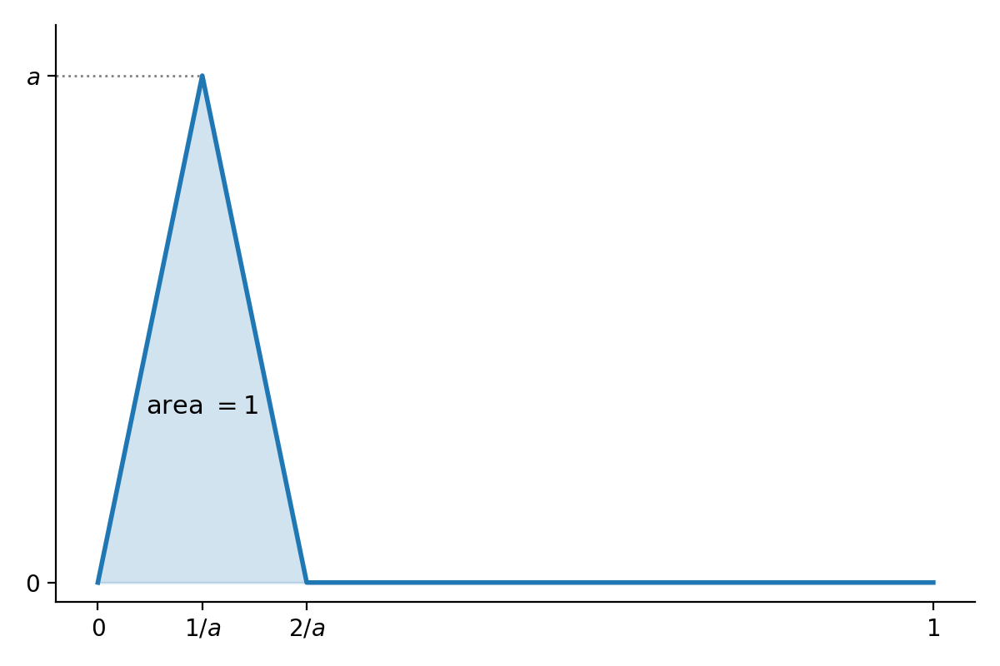

\newcommand{\R}{\mathbf{R}}
\newcommand{\C}{\mathbf{C}}
\newcommand{\supnorm}[1]{\|#1\|_{\mathrm{sup}}}
\newcommand{\frobnorm}[1]{\|#1\|_{F}}
\newcommand{\re}{\operatorname{Re}}
\newcommand{\trace}[1]{\mathrm{trace}(#1)}

Our discussion in this section follows, in part,  Conrad's expository note [Computing the Norm of a Matrix](https://kconrad.math.uconn.edu/blurbs/linmultialg/matrixnorm.pdf).

## Vector Space Norms

Let $V$ be a vector space over $F$, where $F$ is either $\R$ or $\C$.  A norm on $V$
is a function $\|\cdot\|:V\to \R$ such that:

- $\|v\|\ge 0$ for all $v\in V$, with equality if and only if $v=0$. 
- $\|v+w\|\le \|v\|+\|w\|$ for all $v,w\in V$.
- $\|cv\|=|c|\|v\|$ for all $c\in F$ and $v\in V$.

A function satisfying all these conditions except the requirement that $\|v\|=0$ only if $v=0$ is called a seminorm.

These properties guarantee that the  function $d(v,w)=\|v-w\|$ satisfies the definition of a *metric* on $V$.

There are two key examples of such norms.

1. The "sup" norm relative to a basis.   Choose a basis $e_{1},\ldots, e_{n}$ for $V$.  Then define
$$
\left\|\sum_{i=1}^{n} a_{i}e_{i}\right\|_{\mathrm{sup}} =\sup\{|a_1|,\ldots, |a_{n}|\}.
$$

2. The "Euclidean" norm or $\ell^{2}$ norm defined by an inner product $\langle \cdot,\cdot\rangle$:

$$
\|v\| = \sqrt{\langle v,v\rangle}.
$$

The fact that this satisfies the triangle inequality is a consequence of the Cauchy--Schwarz inequality (proved [here](../Week5-6/W05.1.qmd#cauchy-schwarz) for real vector spaces):

$$
|\langle v,w\rangle|\le \sqrt{\langle v,v\rangle \langle w,w\rangle}.
$$

Explicitly, 
$$\begin{aligned}
\|v+w\|^2&=\langle v+w, v+w\rangle \\
 &= \langle v,v\rangle +2\re\langle v,w\rangle +\langle w,w\rangle \\
&\le \|v\|^2+2|\langle v,w\rangle| +\|w\|^2 \\
&\le \|v\|^2 + 2\|v\|\|w\| + \|w\|^2 \quad\text{(by Cauchy--Schwarz)}\\
&= (\|v\|+\|w\|)^2
\end{aligned}
$$
and taking the square root of both sides gives the triangle inequality. 

If the inner product is the usual dot product, then the $\ell^{2}$ norm gives the  Euclidean distance. 

**Definition:** Two norms $\|\cdot\|_a$ and $\|\cdot\|_{b}$ on a vector space $V$ are *equivalent* if they are each bounded by a constant multiple of the other.  In other words, the two norms are equivalent if there are constants $A>0$ and $B>0$ such that
$$
A\|v\|_{a}\le \|v\|_{b}\le B\|v\|_{a}
$$
for all $v\in V$. 

In fact, on a finite-dimensional vector space $V$ over $\R$ or $\C$, all norms on $V$ are equivalent.  

**Proposition:** All norms on a finite-dimensional vector space $V$ over $\R$ or $\C$ are equivalent.

**Proof:** Choose a basis $e_1,\ldots, e_n$ for $V$
and let 
$$
\supnorm{\sum_{i=1}^{n} a_{i}e_{i}} = \sup_{i}\{|a_{i}|\}.
$$

Now let $\rho$ be any other norm on $V$.     
Then if $v=\sum_{i=1}^{n} a_{i}e_{i}$, we have

$$\begin{aligned}
\rho(v) &= \rho\left(\sum_{i=1}^{n} a_{i}e_{i}\right) \\
&\le \sum_{i=1}^{n} |a_{i}|\rho(e_{i}) \\
&\le \left(\sum_{i=1}^{n}\rho(e_{i})\right)\supnorm{v}
\end{aligned}
$$

Therefore $\rho(v)\le B\supnorm{v}$ with $B=\sum_{i=1}^{n}\rho(e_{i})$. 

**Lemma:** The norm $\rho$ is a continuous function in the metric topology given by $\supnorm{\cdot}$.

**Proof:** Given $\epsilon>0$, we need to find $\delta$ so that $\supnorm{x-y}<\delta$ implies $|\rho(x)-\rho(y)|<\epsilon$.
By the triangle inequality, $|\rho(x)-\rho(y)|\le\rho(x-y)\le B\supnorm{x-y}$, so we can take $\delta=\epsilon/B$ (any $\delta$ works if $B=0$).

**Remark:** The proof so far works even when $\rho$ is only a seminorm, not just a norm, but the next part needs $\rho(v)=0$ only when $v=0$. 

**Lemma:** The unit sphere $\{v : \supnorm{v}= 1\}$ in $V$ is compact.

**Proof:**  The unit ball $\{v:\supnorm{v}\le 1\}$ is compact, since it is either a finite product of copies of the
interval $[-1,1]$ in the real case, or a finite product of copies of the closed disk $\{|z|\le 1\}$ in the complex case.
The open ball $\{v: \supnorm{v}<1\}$ is a finite product of open intervals, or open disks, so it's open. The sphere is the complement
of the open ball in the closed ball, so it's closed; as a closed subset of a compact set, it is compact.

Now consider the norm as a function on the unit sphere. As a continuous function on a compact set, it attains its minimum $A$.
And since $\rho$ is nonzero on the unit sphere, $A>0$.  It follows that, for $v\neq 0$,
$$
\rho\left(\frac{v}{\supnorm{v}}\right)\ge A
$$
and therefore
$$
\rho(v)\ge A\supnorm{v}.
$$

Putting it all together we get
$$
A\supnorm{v}\le \rho(v)\le B\supnorm{v}
$$
as desired. 

**Remark:** The key part of this result is the compactness of the closed intervals in $\R$ or closed disks in $\C$; these
follow in general from the "Heine--Borel" theorem which says that closed and bounded subsets of $\R^{n}$ are compact. In
[Equivalence of Norms](https://kconrad.math.uconn.edu/blurbs/gradnumthy/equivnorms.pdf) Conrad describes the proof of 
a more general result that all norms on a finite-dimensional vector space over a complete valued field (meaning a  field together with a choice of norm that induces a complete topology) are equivalent.

**Corollary:** Let $V$ and $W$ be finite-dimensional vector spaces (over $\R$ or $\C$). Then all linear maps from $V$ to $W$
are continuous in any norm topology.  A set which is bounded in one norm is bounded in any norm; similarly for open, closed,
or compact.   

### The infinite-dimensional case is different

It is very definitely *false* that all norms on an infinite-dimensional real or complex vector space
are equivalent.

For example, consider the space 
$C([0,1])$ of continuous functions on the interval $[0,1]$.  Define two norms on this space.  The first
is the "sup norm":
$$
\supnorm{f} = \sup_{0\le x\le 1} |f(x)|,
$$
and the second is the $L^{1}$ norm:
$$
\|f\|_{L^{1}}= \int_{0}^{1} |f(x)|\,dx.
$$

Notice that we can find a continuous function whose sup norm is arbitrarily large, while its $L^{1}$ norm remains $1$, by looking at a function with a big "spike" but total area $1$ as shown below.
Therefore there is no constant $B$ such that
$$
\supnorm{f}\le B\|f\|_{L^{1}}
$$
for all $f$, and therefore these two norms aren't equivalent. 

{width=70%}

## Matrix Norms

Now we turn to norms on matrices and linear maps.  The first thing to observe is that the space $M_{n\times m}(F)$ of $n\times m$ matrices over $F=\R$ or $F=\C$ is a copy of $F^{nm}$. Therefore we have  the supnorm $\supnorm{\cdot}$ on matrices. In addition, we have 
the "Frobenius norm" $\frobnorm{\cdot}$ which is just the  $\ell^{2}$ or Euclidean
norm.   Our earlier work on equivalence of norms applies and therefore  all norms on the space of matrices are equivalent.

### The operator norm

Let's focus on the case of linear maps $L:F^{m}\to F^{n}$ where $F=\R$ or $F=\C$.  Equivalently, we work with 
 matrices $A\in M_{n\times m}(F)$. Write $\rho_{A}(v)=\|Av\|$. In general,
the function $\rho_{A}(v)=\|Av\|$ is a seminorm on $F^{m}$. Note that here $\|v\|$ is the $\ell^{2}$ norm of $v\in F^{m}$ while $\|Av\|$ is the $\ell^{2}$ norm of $Av$ on $F^{n}$.
Then:

- $\rho_{A}(v)=\|A(v)\|\ge 0$.
- $\rho_{A}(v+w)=\|A(v+w)\| = \|A(v)+A(w)\|\le \|A(v)\|+\|A(w)\| = \rho_{A}(v)+\rho_{A}(w)$
- $\rho_{A}(av) = \|A(av)\| = \|aA(v)\|=|a|\|A(v)\|= |a|\rho_{A}(v)$.

As we pointed out above, this means that
$\rho_{A}$ is a continuous function and there is a constant $C\ge 0$ such that
$$
\rho_{A}(v)\le C\|v\|
$$
for all $v$.  

**Proposition:** There is a smallest real number $b\ge 0$ such that $\rho_{A}(v)\le b\|v\|$ for all $v$. 

**Proof:** 
The sphere $\{v\in F^{m}: \|v\|=1\}$  is closed and bounded, hence compact. 
Since $\rho_{A}$ is continuous,
it attains its maximum and we set $b$ to be this maximum.
Then
$$
\rho_{A}(v/\|v\|)\le b 
$$
so 
$$
\rho_{A}(v)\le b\|v\|
$$
for any $v\not=0$ (and trivially for $v=0$ as well. )

Let $v_{0}$ be the point at which $\rho_{A}(v_{0})=b$.
Then if $\rho_{A}(v)\le c\|v\|$ for all $v$, substituting
$v=v_{0}$ we get
$$
b\le c.
$$

So we have found our $b$. 

**Definition:** The operator norm  $\|A\|$ of $A$ is the number $b$ defined as the maximum 
$$
\|A\| = \max_{v\in F^{m}: \|v\|=1} \|A(v)\|.
$$

**Proposition:**  The operator norm is in fact a norm on $M_{n\times m}(F)$ when $F=\R$ or $F=\C$.  Further, if $B\in M_{m\times p}(F)$, then:

- $\|AB\|\le \|A\|\|B\|$
- $\|A^{*}\|=\|A\|$
- $\|A^{*}A\|=\|AA^{*}\| = \|A\|^2$ and therefore $\|A\|=\sqrt{\|A^{*}A\|}=\sqrt{\|AA^{*}\|}$
- $|\langle Av, w\rangle|\le \|A\|\|v\|\|w\|$ for $v\in F^{m}$, $w\in F^{n}$. 
- The operator norm is equivalent to the sup norm on $M_{n\times m}(F)$ with
$$
\supnorm{A}\le \|A\|\le \sqrt{nm}\supnorm{A}.
$$

In particular the operator norm gives $M_{n\times m}(F)$ the topology of $F^{nm}$, so $M_{n\times m}(F)$ is complete relative to the operator norm (Cauchy sequences relative to the operator norm converge).

**Proof:** This is Theorem 3.4 of [Computing the Norm of a Matrix](https://kconrad.math.uconn.edu/blurbs/linmultialg/matrixnorm.pdf)
To check a few, first notice that:
$$
\|ABv\|\le \|A\|\|Bv\|\le \|A\|\|B\|\|v\|.
$$
Since $\|AB\|$ is the smallest $C$ such that $\|(AB)v\|\le C\|v\|$ for all $v$,  we have $\|AB\|\le \|A\|\|B\|$.

The relationship with the adjoint $A^{*}$ (the conjugate transpose, which is just $A^{\top}$ when $F=\R$) is more interesting. We have
$$
\|Av\|^2 = \langle Av, Av\rangle = \langle v, A^{*}Av\rangle \le \|v\|\|A^{*}Av\|\le \|A^{*}A\|\|v\|^2
$$
by the Cauchy--Schwarz inequality and the definition of the $\|A^{*}A\|$. Taking the maximum over unit vectors $v$,
and using $\|AB\|\le \|A\|\|B\|$, gives
$$
\|A\|^2\le \|A^{*}A\|\le \|A^{*}\|\|A\|.
$$

Clearly $\|A^{*}\|=\|A\|$ if $A=0$.   If $A$ is not zero, divide $\|A\|^2\le \|A^{*}\|\|A\|$ by $\|A\|$ to get
$$
\|A\|\le \|A^{*}\|.
$$

Applying this to $A^{*}$ in place of $A$ (and using $(A^{*})^{*}=A$) gives
$$
\|A^{*}\|\le \|A\|,
$$
so they are equal.  But then
$$
\|A\|^2\le \|A^{*}A\|\le \|A^{*}\|\|A\| = \|A\|^2,
$$
so $\|A\|^{2}=\|A^{*}A\|$. Applying this to $A^{*}$ gives $\|A^{*}\|^{2}=\|AA^{*}\|$, and since $\|A^{*}\|=\|A\|$ we get $\|A\|^{2}=\|AA^{*}\|$.

Also, $|\langle Av, w\rangle|\le \|Av\|\|w\|\le \|A\|\|v\|\|w\|$ by the Cauchy--Schwarz inequality and the definition of $\|A\|$.

**Proposition:** If $n=m$ and $A=A^{*}$, then
$$
\|A\| = \max_{\|v\|=1} |\langle Av, v\rangle| = \max \{|\lambda|\}
$$
where the max is over the set of eigenvalues of $A$. 

**Proof:** We showed above that
$$
|\langle Av, v\rangle|\le \|A\|\|v\|^2\le \|A\|
$$
when $\|v\|=1$.  

Now consider the function
$R:F^{n}\setminus\{0\}\to \R$:
$$
R(v) = \frac{|\langle Av, v\rangle|}{\|v\|^2}.
$$
This function is called the "Rayleigh quotient" for the map $A$.
It is a continuous function of $v$, and since the unit sphere
$\|v\|=1$ is compact, it attains a maximum on that sphere. Let $m\ge 0$
be that maximum.  Since the Rayleigh quotient $R$ is scale invariant in $v$,
we have
$$
R(v)\le  m
$$
for all nonzero $v$.  In other words,
$$
|\langle Av, v\rangle| \le m \|v\|^2
$$
for all nonzero $v$.  Since this is also true when $v=0$, it is true on all
of $F^{n}$.

Since $\|A\|\ge R(v)$ for all nonzero $v$, we also
have $\|A\|\ge m$. 

Now given $v,w\in F^{n}$, we have the "polarization identity":
$$\begin{aligned}
\langle A(v+w),v+w\rangle -\langle A(v-w),v-w\rangle &= 2(\langle Av,w\rangle
+\langle Aw,v \rangle)\\
& = 4\re\langle Av,w\rangle 
\end{aligned}
$$
where we have used that $A=A^{*}$.  Thus
$$
4|\re\langle Av, w\rangle| \le m(\|v+w\|^2 + \|v-w\|^2).
$$
But
$$
\|v+w\|^2 + \|v-w\|^2 = 2(\|v\|^2+\|w\|^2).
$$
If we restrict to unit vectors $v$ and $w$, we have
$$
|\re\langle Av,w\rangle| \le m,
$$
and then, by scaling, that
$$
|\re\langle Av,w\rangle| \le m\|v\|\|w\|
$$
for all $v,w\in F^{n}$.

If $w=Av$, then since $\langle Av,Av\rangle=\|Av\|^2$ is real, we have
$$
|\langle Av, Av\rangle| =\|Av\|^2 \le m\|v\|\|Av\|.
$$
This is trivial if $Av=0$; otherwise, dividing by $\|Av\|$ gives
$$
\|Av\|\le m\|v\|.
$$
This means that $\|A\|\le m$. 
Putting the pieces together gives $\|A\|=m$. 

To conclude, we have to make the connection with eigenvalues. 
Suppose that $u$ is a unit vector such that $|\langle Au,u\rangle|=\|A\|$. 
Let $\alpha=\langle Au,u\rangle = \pm\|A\|$.  Consider
$$
\|Au-\alpha u\|^2 = \|Au\|^2-2\alpha \langle Au,u\rangle+\alpha^2 =\|Au\|^2-\alpha^2,
$$
where we use that
$\alpha$ is real 
and $A=A^{*}$.

Now, since $\|u\|=1$, we know that 
$\|Au\|^2\le \|A\|^2$ and therefore
$$
0 \le \|Au-\alpha u\|^2 \le \|A\|^2-\alpha^2 = 0,
$$
so
$$
Au=\alpha u.
$$

Thus $\pm \|A\|$ is an eigenvalue of $A$. Since
the equation $\|Av\|=|\lambda|\|v\|$ holds for every eigenvalue $\lambda$ and eigenvector $v$, 
every eigenvalue satisfies $|\lambda|\le \|A\|$. Therefore $\|A\|=\max_{i}\{|\lambda_{i}|\}$.

**Corollary:** Let $A$ be any $n\times m$ matrix.  Then $\|A\|$ is
the largest singular value of $A$.

**Proof:** We know that $\|A\|^2 = \|A^{*}A\|$. The matrix
$A^{*}A$ is self-adjoint and has nonnegative eigenvalues that are the squares of the singular values of $A$.
The largest such is $\sigma_{1}^2$,
so $\|A\|=\sigma_{1}$.

The fact that $\|A\|$ is the largest singular value of $A$ explains
why the operator norm is also called the spectral norm. 

### The Frobenius Norm

Recall from our introduction that 
the Frobenius norm is just the $\ell^{2}$ norm on the
$nm$-dimensional space $M_{n\times m}(F)$.  If $A=(a_{ij})$ is in this space, then
$$
\frobnorm{A}^2 = \sum |a_{ij}|^2.
$$

**Lemma:** The inner product on $M_{n\times m}(F)$ defined by
$$
\langle (a_{ij}),(b_{ij})\rangle =\sum a_{ij}\overline{b_{ij}}
$$
can be computed as
$$
\langle A,B\rangle = \trace{B^{*}A}.
$$
In particular,
$$
\frobnorm{A}^2 = \trace{A^{*}A}.
$$

**Proof:** This follows from a calculation with the formula for matrix multiplication.

**Proposition:** The Frobenius norm of $A$ is the square root of the sum of the squares
of the singular values $\sigma_{1}\ge \cdots \ge \sigma_{r}$ of $A$:
$$
\frobnorm{A} = \sqrt{\sum_{i=1}^{r} \sigma_{i}^2}.
$$

**Proof:** This follows from the fact that $\trace{A^{*}A}$
is the sum of the eigenvalues of $A^{*}A$, which are the $\sigma_{i}^{2}$ (together with zeros).

From this result we see that the spectral and Frobenius norms are closely related;
the spectral norm considers the largest singular value, while the Frobenius norm considers them all. 
